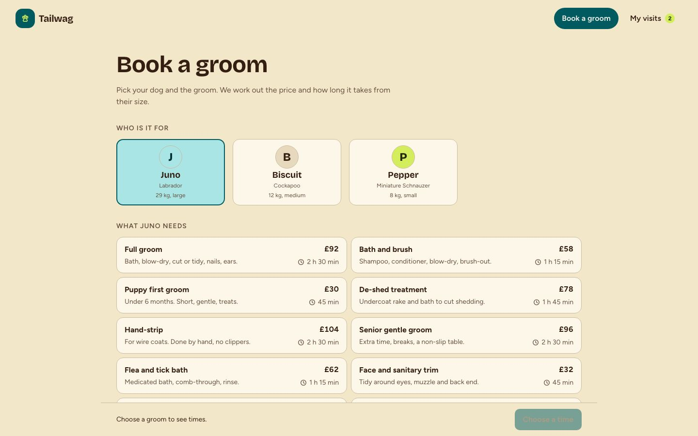
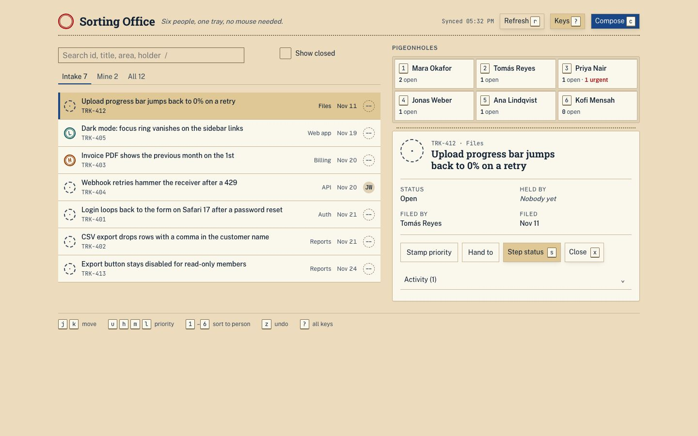
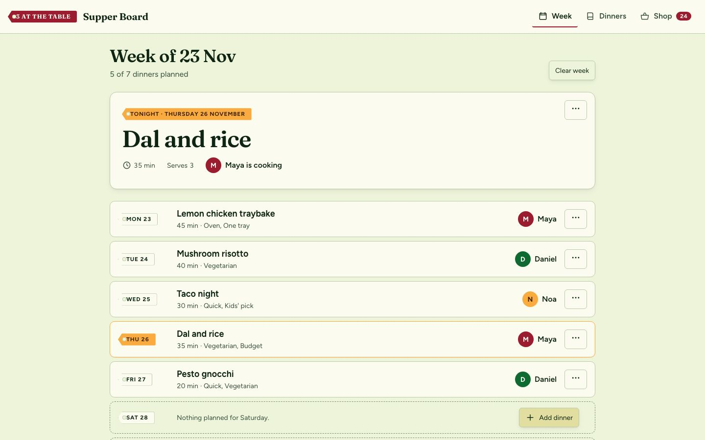

# Round 5: four apps, four frameworks, built from the scaffold

Round 5 rebuilds the four r4 briefs (finance, booking, tracker, meals) by following the `finally-good-ui` skill end to end, this time through its **component-spec flow**: each app's components (button, field, dialog, tabs, toast, and so on) were generated by `scripts/scaffold-component.mjs` for that app's framework and kept as emitted, with the app wired to the scaffold's API. Four apps, four frameworks: React, Svelte, Angular, Vue.

Only the skill side was built this round (no control side).

## The apps

| App | Framework | Direction | Build / checks |
|---|---|---|---|
| [Finance, "Saltmarsh & Rook"](apps/finance/skill) | React 19 + Vite + TS | Tide Table: money as a water level, wavy waterline motif | build passes; `check-components` 0 findings; `check-static` 0 findings (after fixes) |
| [Booking, "Tailwag Grooming"](apps/booking/skill) | Svelte 5 + Vite (JS) | Appointment Card: ticket-stub motif, biscuit and teal | build passes; `check-components` 0; `check-static` 0 high / 0 medium / 1 low |
| [Tracker, "Sorting Office"](apps/tracker/skill) | Angular 21 | Sorting Office: triage as sorting mail, postmark stamps | build passes; `check-components` 0; `check-static` 0; `check-flows` and `component-smoke` not run |
| [Meals, "Supper Board"](apps/meals/skill) | Vue 3 + Vite + TS | Greengrocer's Board: price board, punched hang-tags | build (vue-tsc + vite) passes; `check-components --strict` 0; `check-static` 0 high / 0 medium / 2 low |

Status is as reported in each app's own README. No independent reviewer ran on any app.

## Screenshots (desktop 1440x900, light)

| | |
|---|---|
|  |  |
| **Finance** (React) | **Booking** (Svelte) |
|  |  |
| **Tracker** (Angular) | **Meals** (Vue) |

More views:

| App | Dark | Phone (390x844) |
|---|---|---|
| Finance | [desktop-dark](captures/finance-desktop-dark.jpg) | [phone](captures/finance-phone.jpg) |
| Booking | [desktop-dark](captures/booking-desktop-dark.jpg) | [phone](captures/booking-phone.jpg) |
| Tracker | [desktop-dark](captures/tracker-desktop-dark.jpg) | [phone](captures/tracker-phone.jpg) |
| Meals | [desktop-dark](captures/meals-desktop-dark.jpg) | [phone](captures/meals-phone.jpg) |

These are first-screen stills of each production build, served locally. All 12 loaded with no console errors, page errors or failed requests. Regenerate with `node capture.mjs [app ...]` (needs `playwright-core` and a cached Chromium; the script falls back between two known locations).

## How to run

```sh
cd apps/<finance|booking|tracker|meals>/skill
npm install
npm run dev        # tracker (Angular): npm start
```

`npm run build` makes a production build. Tracker review states: `?state=loading|error|empty`. Finance bank-feed error: `#/?feed=down`.

## Known limits

The apps were built **before the final scaffold fixes** (commit `9ea6aad`, "output compiles under strict tsc, vue-tsc, svelte-check and ngc strictTemplates; two-way props, multiline field, dialog form" and neighbours). Several patches below are therefore already fixed upstream in `skills/finally-good-ui`. The apps were not rebuilt against the fixed scaffold, so their code still carries the patches.

Scaffold patches the builders applied by hand (likely fixed upstream, unverified here):
- **Finance (React):** `button.tsx` `type` typed as `string`, `toggle.tsx` `role={... : null}`, unused `ReactNode` import in `field.tsx` (all failed `tsc -b`); `popovertarget` should be `popoverTarget` in `menu.tsx`; toggle switch CSS used a descendant selector so switches rendered as checkboxes.
- **Meals (Vue):** same `button` and `toggle` type errors under `vue-tsc`; same switch selector bug (5 selectors fixed).
- **Tracker (Angular):** permanent "!" under every field because the error `<p>` was never `:empty` (one-line fix in `field.component.html`); `required` and `readonly` array inputs too strict for templates.
- **Booking (Svelte):** scaffold emits `<script lang="ts">` in a JS project (works via vitePreprocess).

Friction the apps reported that may or may not be closed (not re-checked this round):
- **No bindable or controlled props:** `bind:value` / `v-model` do nothing; apps used `value` + `oninput` and the like (Booking, Meals). The upstream note says two-way props now exist.
- **Tabs:** selection lives in the DOM, no change output or selected prop (all four apps).
- **Dialog:** `open` is one-way; Escape closes in the DOM, so apps mirror it via `onclose` / `@close`. Tracker also lacks an autofocus path and a form submit on Enter.
- **Field:** no multiline (Booking), validation only on `focusout` so apps dispatch `focusout` on submit (Booking, Meals); passing `error` fights the behaviour (Booking).
- **Toast:** no provider or `useToast` (Finance hand-wrote one); fixed bottom-right placement collides with a bottom tab bar (Booking, Meals); string vs number ids (Booking).
- **Density and touch:** `dense` has no touch variant, controls under 44px on phones; toggle control 20px; button spinner animates forever when not busy (Tracker).
- **Disabled button contrast** is very low in both themes (Booking). Visible in its capture: the "Choose a time" button is barely readable.
- **Tooling:** no tool derives a light/dark token pair from a hex palette (Finance, Tracker); autonomous "never install" vs a chosen font that must load (Finance, Tracker); `check-flows` and `component-smoke` need full `playwright` (Tracker).
- Style profile gave the Vue menu trigger no surface (square beside soft cards).

Visible in the captures, not mentioned in the app READMEs (my reading, not verified in the browser beyond the stills):
- Meals: the punched-hole dot on the hang-tags sits tight against the label text ("MON 23", "3 AT THE TABLE"); the active-tab bar in the phone bottom nav spans only the first third.
- Booking phone: the bottom nav shows icons without labels.

## Before / after (r4 skill side vs r5)

Same briefs, same app names. r4 stills are in [`../r4/captures`](../r4/captures); r5 are above.

| App | r4 skill, desktop light | r5 skill, desktop light |
|---|---|---|
| Finance | [r4](../r4/captures/finance-skill-desktop-light.jpg) | [r5](captures/finance-desktop-light.jpg) |
| Booking | [r4](../r4/captures/booking-skill-desktop-light.jpg) | [r5](captures/booking-desktop-light.jpg) |
| Tracker | [r4](../r4/captures/tracker-skill-desktop-light.jpg) | [r5](captures/tracker-desktop-light.jpg) |
| Meals | [r4](../r4/captures/meals-skill-desktop-light.jpg) | [r5](captures/meals-desktop-light.jpg) |

Honest read: this is a process comparison, not a visual-quality verdict. Booking, Meals and (per its README) Finance reuse r4 design files, data and logic, and r4's Booking never rendered at all (an r4 crash found only in r5). What the app READMEs credit r5 with is on the engineering side: components are now real working markup for all specs, r4's empty-skeleton, global-CSS-collision, profile-layer and `role-no-keyboard` false-positive problems did not recur, and the r4 workaround CSS in Booking was deleted. No pairwise reviewer score exists for r5, so no visual improvement is claimed.
