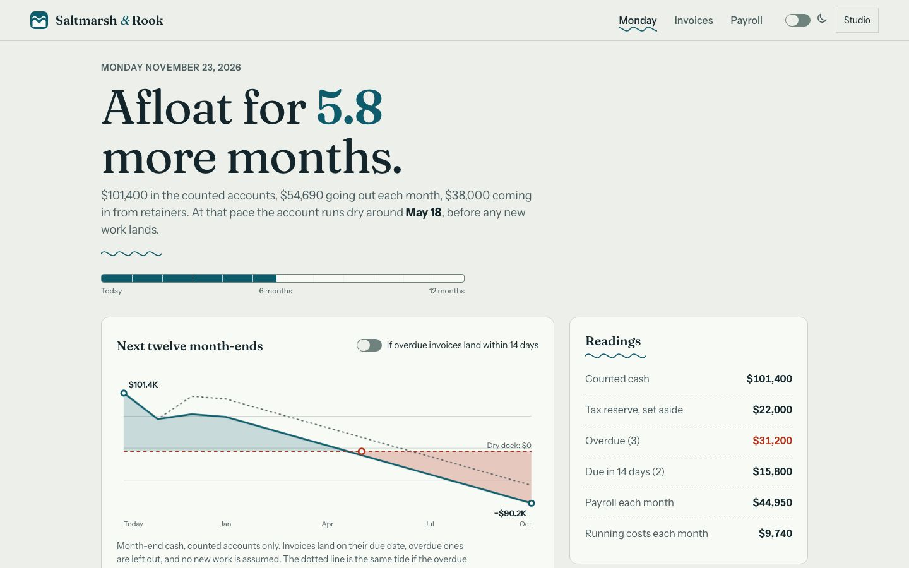

# Round 5: four apps, four frameworks, built from the scaffold

Round 5 rebuilds the four r4 briefs (finance, booking, tracker, meals) by following the `finally-good-ui` skill end to end, this time through its **component-spec flow**: each app's components (button, field, dialog, tabs, toast, and so on) were generated by `scripts/scaffold-component.mjs` for that app's framework and kept as emitted, with the app wired to the scaffold's API. Four apps, four frameworks: React, Svelte, Angular, Vue.

Only the skill side was built this round (no control side).

## The apps

| App | Framework | Direction | Build / checks |
|---|---|---|---|
| [Finance, "Saltmarsh & Rook"](apps/finance/skill) | React 19 + Vite + TS | Tide Table: money as a water level, wavy waterline motif | build passes; `check-components` 0; `check-static` 0 |
| [Booking, "Tailwag Grooming"](apps/booking/skill) | Svelte 5 + Vite (JS) | Appointment Card: ticket-stub motif, biscuit and teal | build passes; `check-components` 0; `check-static` 0 high / 0 medium / 0 low |
| [Tracker, "Sorting Office"](apps/tracker/skill) | Angular 21 | Sorting Office: triage as sorting mail, postmark stamps | build passes; `check-components` 0; `check-static` 0; `check-flows` and `component-smoke` not run |
| [Meals, "Supper Board"](apps/meals/skill) | Vue 3 + Vite + TS | Greengrocer's Board: price board, punched hang-tags | build (vue-tsc + vite) passes; `check-components --strict` 0; `check-static` 0 |

Status is as reported in each app's own README (details below).

## Screenshots (desktop 1440x900, light)

| | |
|---|---|
|  |  |
| **Finance** (React) | **Booking** (Svelte) |
|  |  |
| **Tracker** (Angular) | **Meals** (Vue) |

More views:

| App | Dark | Phone (390x844) |
|---|---|---|
| Finance | [desktop-dark](captures/finance-desktop-dark.jpg) | [phone](captures/finance-phone.jpg) |
| Booking | [desktop-dark](captures/booking-desktop-dark.jpg) | [phone](captures/booking-phone.jpg) |
| Tracker | [desktop-dark](captures/tracker-desktop-dark.jpg) | [phone](captures/tracker-phone.jpg) |
| Meals | [desktop-dark](captures/meals-desktop-dark.jpg) | [phone](captures/meals-phone.jpg) |

These are first-screen stills of each production build, served locally. All 12 (re-captured 2026-11-27 from fresh builds) loaded with no console errors, page errors or failed requests. Regenerate with `node capture.mjs [app ...]` (needs `playwright-core` and a cached Chromium; the script falls back between two known locations).

## How to run

```sh
cd apps/<finance|booking|tracker|meals>/skill
npm install
npm run dev        # tracker (Angular): npm start
```

`npm run build` makes a production build. Tracker review states: `?state=loading|error|empty`. Finance bank-feed error: `#/?feed=down`.

## Rebuilding the live gallery

`node scripts/build-gallery-site.mjs` (repo root) builds the four apps with a sub-path base, copies the captures and component reference pages, and writes the landing page to `_site/` (git-ignored). Flags: `--install` (`npm ci` per app first), `--skip-apps` (reuse existing `dist/`), `--out <dir>`. Env `GALLERY_BASE` (default `/FinallyGoodUI/`) is the URL path it is served under. `.github/workflows/pages.yml` runs it on push to `main`.

## Status of each app

Facts as reported in each app's own README; the builds and captures were re-run on 2026-11-27. No independent reviewer ran on any app.

| App | Build | `check-components --strict` | `check-static` | Console errors | Patches removed vs earlier r5 build |
|---|---|---|---|---|---|
| Finance (React) | `tsc -b` + vite passes | 0 findings | 0 findings | 0 (README browser pass); 0 in the 3 captures | 11 |
| Booking (Svelte) | passes | 0 findings | 0 high / 0 medium / 0 low | 0 (README browser pass); 0 in the 3 captures | 8 |
| Tracker (Angular) | passes | 0 findings | 0 high / 0 medium / 0 low | 0, plus a dev-only NG0956 warning (README); 0 in the 3 captures | 9 |
| Meals (Vue) | `vue-tsc` + vite passes | 0 findings | 0 findings | 0 (README browser pass); 0 in the 3 captures | 6, plus 1 partial |

`check-flows` and `component-smoke` were not run (Tracker README: they need the full `playwright` package). Reduced-motion and screen-reader passes are not covered for Finance and Meals.

## Built with the final scaffold

All four apps were regenerated with the final `scripts/scaffold-component.mjs` (commit `9ea6aad` and neighbours) and rebuilt. Generated component files are used as emitted: no hand patches to scaffold output. The earlier r5 build carried such patches (typing fixes, a toggle selector fix, a field error element fix and similar); the counts above are what each README lists as removed, along with app-side workarounds the new scaffold API made unnecessary (two-way props, `initialFocus`, dialog form submit, tabs selection output).

## Remaining friction (skill gaps)

Taken from each app's "Remaining friction" list and merged. These are tracked for the scaffold; none is claimed as fixed here.

| Gap | Seen in | App-side workaround today |
|---|---|---|
| No submit-time "show every error" on Field (validates on blur or focusout only) | Finance, Booking, Tracker, Meals | App computes messages and passes `error`, or dispatches `focusout` on invalid controls (`src/forms.ts`, `Review.svelte`) |
| `--toast-offset` moves both axes, so clearance above a bottom tab bar needs a CSS override | Finance, Booking, Meals | One `inset-block-end` rule in app CSS |
| No toast provider or `useToast` | Finance, Booking, Tracker (store wraps it) | App owns the toast list (`src/lib/toasts.tsx` in Finance) |
| Toast callbacks: `dismiss` gives a string id (`dataset.id`), `onAction` gets the toast but dismiss only an id | Booking, Tracker | App converts with `String()` or wraps in the store |
| `ng build` fails under `noPropertyAccessFromIndexSignature` (`toast.component.ts` reads `dataset.id`, TS4111); scaffold should use `dataset['id']` | Tracker | `"noPropertyAccessFromIndexSignature": false` in `tsconfig.json` |
| Dialog form: no `novalidate`, so native bubbles precede app messages; Enter in a single-field body submits and closes a `method=dialog` form | Finance, Tracker, Meals | `formNoValidate` + `preventDefault`, or `@submit.prevent` on the dialog |
| `toggle` `checked` is initial-only (React `defaultChecked`) | Finance | Switches follow `onChange` instead of re-passed `checked` |
| `dense` density has no touch variant (controls 32px on touch) | Tracker | `(pointer: coarse)` override |
| Field cannot hide its label visually; empty error line still takes space | Tracker | `.quiet-label` rule |
| Menu trigger gets no surface from the style profile (square under `radius: soft`) | Meals | One rule in `base.css` |
| Tabs take only `string[]` labels (no count badge, no id/label split); `panel` receives the label | Booking | App matches on the label |
| Dialog `title` / `description` are snippets, not string props | Booking | Used as snippets |
| `disclosure` is one item per component; menu has no label prop | Meals | Visually hidden span in the slot |
| Libraries: `radix-ui` installed but the scaffold wires none of it (no `Primitive` export in the unified package) | Finance | Dead dependency |
| Tooling: no light/dark token pair from a hex palette; `contrast.mjs` output verbose (a `--ratio` flag was suggested) | Finance, Tracker | Throwaway scripts |
| Tooling: "never install" rule vs a chosen font that must load; `emit-tokens --format css` repeats the family name | Finance, Tracker | Fontsource installs, manual stack edit |
| Tooling: `check-flows` and `component-smoke` need full `playwright`, not `playwright-core` | Tracker | Walk driven with `playwright-core` |
| Tooling: probe focus walk inflates CLS (opens menus and disclosures); `dist/` not covered by the repo `.gitignore` | Tracker, Meals | Ignore the number; do not stage `dist/` |

Not skill gaps, listed for completeness: Booking fixed a `When.svelte` default-day effect ordering bug and notes parallel agents sharing a scratchpad; Tracker has a dev-only NG0956 "track by identity" warning, not in the production build.

Cosmetic fixes made after the first capture (app-side only; before-images are in [`captures/before`](captures/before)), each re-verified at 390px and 1440px, light and dark, with 0 console errors, `check-components --strict` ok and `check-static` 0 findings:
- Meals: the hang-tag punch hole now has a gap before the label (`HangTag.vue`); the phone tab bar is three equal grid columns with the Shop count badge floated over the icon, so all labels share one baseline and each active bar is exactly one tab wide.
- Booking: the disabled "Choose a time" button uses `--color-foreground` on `--color-muted` (about 11:1 light, 10.9:1 dark; was 5.4:1 and 6.1:1 with the generated muted-on-muted pair) plus a dashed border. The phone tab bar labels were being pushed off-screen on touch emulation: the `step-in` slide-in made the layout viewport 12px wider, so the fixed bar's bottom edge sat 26px below the screen; `.shell { overflow-x: clip }` fixes it.
- Finance: the brand stays on one line at 390px (`text-base`, `nowrap`, tighter gaps).

Friction worth feeding back to the scaffold: the generated button's disabled pair (muted-foreground on muted) passes 4.5:1 but reads faint, so Booking overrides it in app CSS; and a page-level entrance transform with no `overflow-x: clip` can widen the layout viewport on touch devices, which a desktop-viewport check will not show.

## Before / after (r4 skill side vs r5)

Same briefs, same app names. r4 stills are in [`../r4/captures`](../r4/captures); r5 are above.

| App | r4 skill, desktop light | r5 skill, desktop light |
|---|---|---|
| Finance | [r4](../r4/captures/finance-skill-desktop-light.jpg) | [r5](captures/finance-desktop-light.jpg) |
| Booking | [r4](../r4/captures/booking-skill-desktop-light.jpg) | [r5](captures/booking-desktop-light.jpg) |
| Tracker | [r4](../r4/captures/tracker-skill-desktop-light.jpg) | [r5](captures/tracker-desktop-light.jpg) |
| Meals | [r4](../r4/captures/meals-skill-desktop-light.jpg) | [r5](captures/meals-desktop-light.jpg) |

Honest read: this is a process comparison, not a visual-quality verdict. Booking, Meals and (per its README) Finance reuse r4 design files, data and logic, and r4's Booking never rendered at all (an r4 crash found only in r5). What the app READMEs credit r5 with is on the engineering side: components are now real working markup for all specs, r4's empty-skeleton, global-CSS-collision, profile-layer and `role-no-keyboard` false-positive problems did not recur, and the r4 workaround CSS in Booking was deleted. No pairwise reviewer score exists for r5, so no visual improvement is claimed.
